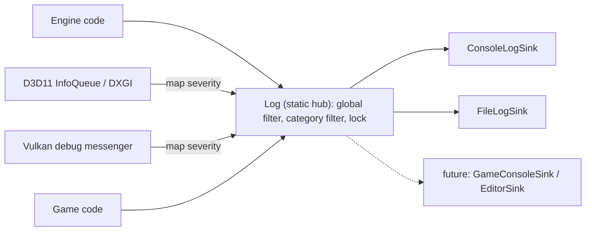

Analyzed Torture.csproj:L1-20
Analyzed Log.cs:L1-49
Analyzing Log.cs
Analyzed Torture.slnx:L1-21
Used tool: invoke_subagent

Изучаю новую структуру и все текущие точки логирования, после этого дам дизайн.

# Система логирования: статический `Log`, синки, severity и категории

Изучил новую структуру: `src/Torture/{Core, Diagnostics, Graphics, …}`, пространства имён `Torture.Core`, `Torture.Diagnostics` и т.д. Ниже архитектура, готовый код и список мест, которые нужно перевести на новую систему.

## 0. Архитектура



Ключевые решения:

| Решение | Почему |
|---|---|
| `LogSeverity`: Trace, Debug, Info, Warning, Error, Fatal | Это надмножество уровней nvrhi (Info/Warning/Error/Fatal), D3D11 (Message/Info/Warning/Error/Corruption) и Vulkan (Verbose/Info/Warning/Error), так что все три сводятся в одну шкалу без потерь |
| `LogCategory` — **класс**, а не строка или enum | У строки нет защиты от опечаток. Enum в Core нельзя расширить из бэкенда или игры. Экземпляр класса даёт идентичность и **свой фильтр уровня в рантайме**: `D3D11.MinimumSeverity = Warning` |
| Категории объявляются **там, где живут** | `Core`/`Graphics`/`Memory` в Torture, `D3D11`/`DXGI` в Torture.Direct3D11, `Vulkan` в Torture.Vulkan. Ядро ничего не знает о бэкендах |
| `LogMessage.Id` | Номер сообщения у D3D11 и Vulkan (`MessageId`, `messageIdNumber`). По нему потом удобно глушить конкретные шумные сообщения |
| Три уровня фильтров: глобальный → категория → синк | Общий шум режется до форматирования, а каждый синк дополнительно выбирает своё (например, консоль только Info+, а файл всё) |
| `Log` потокобезопасен, синки вызываются под одним lock | Callback Vulkan вызывается из потоков драйвера. Синкам не нужно думать о потоках |
| `Trace`/`Debug` вырезаются через `TORTURE_LOG`, `Info` и выше остаются всегда | **Изменение по сравнению с прошлым вариантом:** файловому логу в Release нужен `Info` (адаптер, опции, версия), иначе в баг-репорте пусто |

---

## 1. Новые файлы

Все файлы кладём в `src/Torture/Diagnostics/Logging/`. Пространство имён — `Torture.Diagnostics`, по той же схеме, что у вас в `Graphics/Vertices`.

### `LogSeverity.cs`
```csharp
namespace Torture.Diagnostics;

/// <summary>Message severity. Superset of NVRHI, D3D11 and Vulkan severities.</summary>
public enum LogSeverity : byte
{
    Trace,
    Debug,
    Info,
    Warning,
    Error,
    Fatal,

    /// <summary>Filter-only value: disables all messages.</summary>
    None
}
```

### `LogCategory.cs`
```csharp
namespace Torture.Diagnostics;

/// <summary>Named log channel with its own runtime severity filter.</summary>
public sealed class LogCategory
{
    public LogCategory(string name, LogSeverity minimumSeverity = LogSeverity.Trace)
    {
        ArgumentException.ThrowIfNullOrWhiteSpace(name);
        Name = name;
        MinimumSeverity = minimumSeverity;
    }

    public string Name { get; }

    /// <summary>Messages below this severity are discarded for this category. Can be changed at runtime.</summary>
    public LogSeverity MinimumSeverity { get; set; }

    public override string ToString() => Name;
}

/// <summary>Engine-level categories. Backends and games declare their own.</summary>
public static class LogCategories
{
    public static readonly LogCategory Core = new("Core");
    public static readonly LogCategory Graphics = new("Graphics");
    public static readonly LogCategory Memory = new("Memory");
    public static readonly LogCategory Input = new("Input");
    public static readonly LogCategory Sdl = new("SDL");
}
```

### `LogMessage.cs`
```csharp
namespace Torture.Diagnostics;

/// <summary>A single log entry passed to sinks.</summary>
/// <param name="Timestamp">UTC time of the message.</param>
/// <param name="Id">Source-specific message id (D3D11 MessageId, Vulkan messageIdNumber); 0 for engine messages.</param>
public readonly record struct LogMessage(
    DateTime Timestamp,
    LogSeverity Severity,
    LogCategory Category,
    string Text,
    int Id,
    int ThreadId,
    Exception? Exception);
```

### `ILogSink.cs`
```csharp
namespace Torture.Diagnostics;

/// <summary>Log output target. Calls are serialized by <see cref="Log"/>, so implementations need not be thread-safe.</summary>
public interface ILogSink : IDisposable
{
    /// <summary>Messages below this severity are not delivered to the sink.</summary>
    LogSeverity MinimumSeverity { get; }

    /// <summary>Writes a message. Must not call <see cref="Log"/> (such messages are dropped).</summary>
    void Write(in LogMessage message);

    void Flush();
}
```

### `Log.cs` (заменяет старый)
```csharp
namespace Torture.Diagnostics;

/// <summary>
/// Static logging hub. It does not write anywhere by itself: messages are dispatched to registered sinks.
/// Thread-safe. Trace and Debug calls are stripped at compile time unless TORTURE_LOG is defined.
/// </summary>
public static class Log
{
    public const string Symbol = "TORTURE_LOG";

    private static readonly Lock s_lock = new();
    private static ILogSink[] s_sinks = [];

    [ThreadStatic]
    private static bool t_isDispatching;

    /// <summary>Global runtime filter, checked before category and sink filters.</summary>
    public static LogSeverity MinimumSeverity { get; set; } =
#if TORTURE_LOG
        LogSeverity.Trace;
#else
        LogSeverity.Info;
#endif

    public static void AddSink(ILogSink sink)
    {
        ArgumentNullException.ThrowIfNull(sink);
        lock (s_lock)
        {
            s_sinks = [.. s_sinks, sink];
        }
    }

    public static bool RemoveSink(ILogSink sink)
    {
        lock (s_lock)
        {
            int index = Array.IndexOf(s_sinks, sink);
            if (index < 0)
            {
                return false;
            }
            s_sinks = [.. s_sinks[..index], .. s_sinks[(index + 1)..]];
            return true;
        }
    }

    /// <summary>Cheap pre-check to skip expensive message formatting.</summary>
    public static bool IsEnabled(LogSeverity severity, LogCategory category)
        => severity >= MinimumSeverity
        && severity >= category.MinimumSeverity
        && s_sinks.Length != 0;

    public static void Write(LogSeverity severity, LogCategory category, string text, int id = 0, Exception? exception = null)
    {
        if (!IsEnabled(severity, category))
        {
            return;
        }

        var message = new LogMessage(DateTime.UtcNow, severity, category, text, id, Environment.CurrentManagedThreadId, exception);

        lock (s_lock)
        {
            // A sink that logs would recurse into itself; such messages are dropped.
            if (t_isDispatching)
            {
                return;
            }

            t_isDispatching = true;
            try
            {
                foreach (ILogSink sink in s_sinks)
                {
                    if (severity < sink.MinimumSeverity)
                    {
                        continue;
                    }

                    try
                    {
                        sink.Write(in message);
                    }
                    catch (Exception ex)
                    {
                        // A broken sink must never crash the game.
                        System.Diagnostics.Debug.WriteLine($"[Log] {sink.GetType().Name} failed: {ex}");
                    }
                }
            }
            finally
            {
                t_isDispatching = false;
            }
        }
    }

    [System.Diagnostics.Conditional(Symbol)]
    public static void Trace(LogCategory category, string text) => Write(LogSeverity.Trace, category, text);

    [System.Diagnostics.Conditional(Symbol)]
    public static void Debug(LogCategory category, string text) => Write(LogSeverity.Debug, category, text);

    public static void Info(LogCategory category, string text) => Write(LogSeverity.Info, category, text);

    public static void Warning(LogCategory category, string text) => Write(LogSeverity.Warning, category, text);

    public static void Error(LogCategory category, string text, Exception? exception = null)
        => Write(LogSeverity.Error, category, text, exception: exception);

    public static void Fatal(LogCategory category, string text, Exception? exception = null)
        => Write(LogSeverity.Fatal, category, text, exception: exception);

    public static void Flush()
    {
        lock (s_lock)
        {
            foreach (ILogSink sink in s_sinks)
            {
                try { sink.Flush(); } catch { /* ignored on purpose */ }
            }
        }
    }

    /// <summary>Flushes and disposes all sinks. Call once at application exit.</summary>
    public static void Shutdown()
    {
        lock (s_lock)
        {
            foreach (ILogSink sink in s_sinks)
            {
                try { sink.Flush(); sink.Dispose(); } catch { /* ignored on purpose */ }
            }
            s_sinks = [];
        }
    }
}
```

> ⚠️ Внутри класса `Log` есть метод `Debug`, поэтому простое имя `Debug` там означает метод, а не `System.Diagnostics.Debug`. Отсюда полные имена `System.Diagnostics.Debug.WriteLine` и `System.Diagnostics.Conditional`.

### `LogFormatter.cs`: общий формат строки для текстовых синков
```csharp
using System.Globalization;

namespace Torture.Diagnostics;

/// <summary>Shared single-line text format for text-based sinks.</summary>
public static class LogFormatter
{
    public static string SeverityTag(LogSeverity severity) => severity switch
    {
        LogSeverity.Trace => "TRACE",
        LogSeverity.Debug => "DEBUG",
        LogSeverity.Info => "INFO ",
        LogSeverity.Warning => "WARN ",
        LogSeverity.Error => "ERROR",
        LogSeverity.Fatal => "FATAL",
        _ => "?????"
    };

    // Output: 2026-11-18 16:22:19.123 WARN  [D3D11 #342] (T1) STATE_CREATION: ...
    public static void Write(TextWriter writer, in LogMessage message, bool includeDate, bool includeThread)
    {
        DateTime local = message.Timestamp.ToLocalTime();
        writer.Write(local.ToString(includeDate ? "yyyy-MM-dd HH:mm:ss.fff" : "HH:mm:ss.fff", CultureInfo.InvariantCulture));
        writer.Write(' ');
        writer.Write(SeverityTag(message.Severity));
        writer.Write(" [");
        writer.Write(message.Category.Name);
        if (message.Id != 0)
        {
            writer.Write(" #");
            writer.Write(message.Id.ToString(CultureInfo.InvariantCulture));
        }
        writer.Write("] ");
        if (includeThread)
        {
            writer.Write("(T");
            writer.Write(message.ThreadId.ToString(CultureInfo.InvariantCulture));
            writer.Write(") ");
        }
        writer.WriteLine(message.Text);

        if (message.Exception is not null)
        {
            writer.WriteLine(message.Exception.ToString());
        }
    }
}
```

### `Sinks/ConsoleLogSink.cs`
```csharp
namespace Torture.Diagnostics;

/// <summary>Writes colored log lines to the process console.</summary>
public sealed class ConsoleLogSink : ILogSink
{
    public LogSeverity MinimumSeverity { get; set; } = LogSeverity.Trace;

    public void Write(in LogMessage message)
    {
        ConsoleColor previous = Console.ForegroundColor;
        Console.ForegroundColor = message.Severity switch
        {
            LogSeverity.Fatal => ConsoleColor.Magenta,
            LogSeverity.Error => ConsoleColor.Red,
            LogSeverity.Warning => ConsoleColor.Yellow,
            LogSeverity.Info => ConsoleColor.Gray,
            LogSeverity.Debug => ConsoleColor.DarkCyan,
            _ => ConsoleColor.DarkGray
        };
        LogFormatter.Write(Console.Out, message, includeDate: false, includeThread: false);
        Console.ForegroundColor = previous;
    }

    public void Flush() => Console.Out.Flush();

    public void Dispose() { }
}
```

### `Sinks/FileLogSink.cs`
```csharp
using System.Diagnostics;
using System.Runtime.InteropServices;
using System.Text;

namespace Torture.Diagnostics;

/// <summary>
/// Writes log lines to a UTF-8 file. The previous session's log is kept as "*.prev.log".
/// Buffered: flushes on severe messages, at most once per second otherwise, and on dispose.
/// </summary>
public sealed class FileLogSink : ILogSink
{
    private static readonly long AutoFlushIntervalTicks = Stopwatch.Frequency; // 1 second

    private readonly StreamWriter _writer;
    private long _lastFlushTimestamp;

    public FileLogSink(string path, bool keepPreviousLog = true)
    {
        string? directory = Path.GetDirectoryName(path);
        if (!string.IsNullOrEmpty(directory))
        {
            Directory.CreateDirectory(directory);
        }

        try
        {
            if (keepPreviousLog && File.Exists(path))
            {
                File.Move(path, Path.ChangeExtension(path, ".prev.log"), overwrite: true);
            }
            _writer = Open(path);
        }
        catch (IOException)
        {
            // The file is locked, most likely by another running instance: fall back to a per-process file.
            path = Path.ChangeExtension(path, $".{Environment.ProcessId}.log");
            _writer = Open(path);
        }

        FilePath = path;
        _writer.WriteLine(
            $"=== Log started {DateTime.Now:yyyy-MM-dd HH:mm:ss} | {RuntimeInformation.OSDescription} | " +
            $".NET {Environment.Version} | PID {Environment.ProcessId} ===");
        _lastFlushTimestamp = Stopwatch.GetTimestamp();
    }

    public string FilePath { get; }

    public LogSeverity MinimumSeverity { get; set; } = LogSeverity.Trace;

    /// <summary>Messages at or above this severity are flushed immediately so they survive a crash.</summary>
    public LogSeverity FlushSeverity { get; set; } = LogSeverity.Error;

    public void Write(in LogMessage message)
    {
        LogFormatter.Write(_writer, message, includeDate: true, includeThread: true);

        long now = Stopwatch.GetTimestamp();
        if (message.Severity >= FlushSeverity || now - _lastFlushTimestamp >= AutoFlushIntervalTicks)
        {
            _writer.Flush();
            _lastFlushTimestamp = now;
        }
    }

    public void Flush() => _writer.Flush();

    public void Dispose()
    {
        _writer.WriteLine($"=== Log closed {DateTime.Now:yyyy-MM-dd HH:mm:ss} ===");
        _writer.Dispose();
    }

    private static StreamWriter Open(string path) => new(
        path,
        new UTF8Encoding(encoderShouldEmitUTF8Identifier: false),
        new FileStreamOptions
        {
            Mode = FileMode.Create,
            Access = FileAccess.Write,
            Share = FileShare.Read // allows tailing the log while the game runs
        });
}
```

Учтите: сброс на диск «раз в секунду» срабатывает при следующей записи, а не по таймеру. Если игра молчит, последние строки лежат в буфере до `Shutdown`. Error и Fatal пишутся на диск сразу, а это главное для разбора крэшей.

---

## 2. Интеграция в `Application.cs`

```csharp
using System.Runtime.InteropServices;

public static SDL.AppResult AppInit(out TApp? appState, string[] args)
{
    appState = new TApp();
    appState.ConfigureLogging(args);
    AppDomain.CurrentDomain.UnhandledException += OnUnhandledException;

    Log.Info(LogCategories.Core,
        $"{appState.Title} {appState.Version} | {RuntimeInformation.OSDescription} | .NET {Environment.Version}");

    try
    {
        return appState.InternalInit(args);
    }
    catch (Exception ex)
    {
        Log.Fatal(LogCategories.Core, "Initialization failed.", ex);
        return SDL.AppResult.Failure;
    }
}

/// <summary>Registers log sinks. Called first, right after the application instance is created.</summary>
protected virtual void ConfigureLogging(string[] args)
{
    Log.AddSink(new ConsoleLogSink());
    Log.AddSink(new FileLogSink(GetDefaultLogFilePath()));
}

/// <summary>%LocalAppData%/{Identifier}/Logs/latest.log on Windows, ~/.local/share/... on Linux.</summary>
protected string GetDefaultLogFilePath() => Path.Combine(
    Environment.GetFolderPath(Environment.SpecialFolder.LocalApplicationData), Identifier, "Logs", "latest.log");

private static void OnUnhandledException(object sender, UnhandledExceptionEventArgs e)
{
    Log.Fatal(LogCategories.Core, "Unhandled exception.", e.ExceptionObject as Exception);
    Log.Shutdown();
}
```

**Обернуть `AppIterate` и `AppEvent`.** Их вызывает SDL из нативного кода. Исключение, которое выходит из managed-колбэка в нативный стек, обычно сразу роняет процесс. `UnhandledException` в этом случае может не сработать, и в файл ничего не попадёт. В .NET `try/catch` ничего не стоит, пока исключение не брошено, так что per-frame это бесплатно:

```csharp
public SDL.AppResult AppIterate()
{
    try
    {
        return IterateCore(); // the current AppIterate body, renamed
    }
    catch (Exception ex)
    {
        Log.Fatal(LogCategories.Core, "Unhandled exception in the main loop.", ex);
        return SDL.AppResult.Failure;
    }
}
```
С `AppEvent` то же самое: вынести тело в `HandleEventCore(ref e)`.

**`AppQuit`.** SDL вызывает его всегда, даже если `AppInit` вернул Failure:
```csharp
public void AppQuit(SDL.AppResult result)
{
    try
    {
        // ... existing shutdown code (GraphicsDevice.Dispose logs leaks, so it must run before Log.Shutdown) ...
        SDL.Quit();
        Log.Info(LogCategories.Core, $"Shutdown complete ({result}).");
    }
    catch (Exception ex)
    {
        Log.Fatal(LogCategories.Core, "Shutdown failed.", ex);
    }
    finally
    {
        Log.Shutdown();
    }
}
```

Ограничение: всё, что залогировано в конструкторе `TApp`, пропадёт, потому что синков ещё нет. Сейчас там ничего не логируется, но это стоит помнить.

---

## 3. Перевод существующих мест

| Место | Было | Стало |
|---|---|---|
| `Core/Application.cs:182` | `Log.Info("Graphics", ...)` | `Log.Info(LogCategories.Graphics, ...)` |
| `Core/Application.cs:204, 213` | `SDL.LogError(SDL.LogCategory.Application, ...)` | `Log.Error(LogCategories.Sdl, $"Couldn't initialize SDL: {SDL.GetError()}")` |
| `Core/GarbageCollection.cs:41` | `Log.Info("GC", ...)` | `Log.Info(LogCategories.Memory, ...)`. `[Conditional(Log.Symbol)]` у `LogStats` можно оставить |
| `Diagnostics/AllocationTracker.cs:108, 142` | `Console.WriteLine(...)` | `Log.Warning(LogCategories.Memory, ...)` |
| `Diagnostics/AllocationTracker.cs:150` | `Console.WriteLine($"[GC] ...")` | `Log.Info(LogCategories.Memory, ...)`. Префиксы `[Alloc]`/`[GC]` убрать, их заменяет категория |
| `Luna.cs:178` | `Console.WriteLine($"Luna | FPS ...")` | `Log.Debug(LunaLog, ...)`, где `private static readonly LogCategory LunaLog = new("Luna");` |
| D3D11 (8 мест) | см. раздел 4 | |

В `AllocationTracker` вызовы `Log` стоят до снимка `s_frameEnd`, так что аллокации логгера по-прежнему не попадают в замер ✅.

---

## 4. D3D11 и DXGI

Категории объявляем в проекте бэкенда, например в новом файле `src/Torture.Direct3D11/D3D11LogCategories.cs`:
```csharp
using Torture.Diagnostics;

namespace Torture.Direct3D11;

public static class D3D11LogCategories
{
    public static readonly LogCategory D3D11 = new("D3D11");
    public static readonly LogCategory Dxgi = new("DXGI");
    public static readonly LogCategory SharpGen = new("SharpGen");
}
```

Таблица соответствия уровней:

| D3D11 / DXGI | Vulkan | nvrhi | `LogSeverity` |
|---|---|---|---|
| Corruption | — | Fatal | **Fatal** |
| Error | ERROR | Error | **Error** |
| Warning | WARNING | Warning | **Warning** |
| Info | INFO | Info | **Debug** (это поток «created buffer…», в Info он будет шуметь) |
| Message | VERBOSE | — | **Trace** |

В `D3D11GraphicsDevice.cs`:
```csharp
private static LogSeverity ToLogSeverity(MessageSeverity severity) => severity switch
{
    MessageSeverity.Corruption => LogSeverity.Fatal,
    MessageSeverity.Error => LogSeverity.Error,
    MessageSeverity.Warning => LogSeverity.Warning,
    MessageSeverity.Info => LogSeverity.Debug,
    _ => LogSeverity.Trace
};

private void FlushDebugMessages()
{
    if (_infoQueue is null || _infoQueue.NativePointer == nint.Zero)
    {
        return;
    }

    ulong count = _infoQueue.NumStoredMessages;
    for (ulong i = 0; i < count; i++)
    {
        Message msg = _infoQueue.GetMessage(i);
        Log.Write(ToLogSeverity(msg.Severity), D3D11LogCategories.D3D11, $"{msg.Category}: {msg.Description}", (int)msg.Id);
    }
    _infoQueue.ClearStoredMessages();
}
```
- Для DXGI нужна такая же функция для `InfoQueueMessageSeverity` (те же пять значений), вызов `Log.Write(..., D3D11LogCategories.Dxgi, ..., msg.Id)`.
- Для SharpGen: `Log.Warning(D3D11LogCategories.SharpGen, ...)`.
- Строки вида «Validation requested, but…» и «Debug layer enabled» переводятся на `D3D11LogCategories.D3D11`.
- Шум теперь можно убрать без пересборки: `D3D11LogCategories.D3D11.MinimumSeverity = LogSeverity.Warning;`.
- Ещё эффективнее отсекать шум на стороне D3D: у `ID3D11InfoQueue` есть storage-фильтры (`PushStorageFilter` с deny-списком по severity или id). Тогда сообщения уровня Info вообще не попадают в очередь, и `GetMessage` на них не тратится.

Алиас `TortDiag` можно оставить, если без него был конфликт имён. Новые имена `LogSeverity`/`LogCategory` с типами Vortice (`MessageSeverity`/`MessageCategory`) не пересекаются.

---

## 5. Vulkan: набросок на будущее

Vulkan-бэкенд у вас пока пустой. Когда дойдёте до debug messenger, схема будет такой. Имена типов Vortice.Vulkan сверяйте с версией пакета:

```csharp
public static class VulkanLogCategories
{
    public static readonly LogCategory Vulkan = new("Vulkan");
}

[UnmanagedCallersOnly]
private static unsafe uint DebugMessengerCallback(
    VkDebugUtilsMessageSeverityFlagsEXT severity,
    VkDebugUtilsMessageTypeFlagsEXT types,
    VkDebugUtilsMessengerCallbackDataEXT* data,
    void* userData)
{
    try
    {
        LogSeverity logSeverity =
            (severity & VkDebugUtilsMessageSeverityFlagsEXT.Error) != 0 ? LogSeverity.Error :
            (severity & VkDebugUtilsMessageSeverityFlagsEXT.Warning) != 0 ? LogSeverity.Warning :
            (severity & VkDebugUtilsMessageSeverityFlagsEXT.Info) != 0 ? LogSeverity.Debug :
            LogSeverity.Trace;

        if (Log.IsEnabled(logSeverity, VulkanLogCategories.Vulkan))
        {
            string text = Marshal.PtrToStringUTF8((nint)data->pMessage) ?? string.Empty;
            Log.Write(logSeverity, VulkanLogCategories.Vulkan, $"{types}: {text}", data->messageIdNumber);
        }
    }
    catch
    {
        // Exceptions must never cross the native boundary.
    }
    return 0; // VK_FALSE: do not abort the Vulkan call
}
```
Два момента:
- этот callback может прийти из **потоков драйвера**: `Log` потокобезопасен, так что всё в порядке;
- `IsEnabled` проверяется до маршалинга строки, чтобы не выделять память на отфильтрованные сообщения.

---

## 6. Синк для игровой консоли или редактора (потом)

Достаточно реализовать `ILogSink`. Например, кольцевой буфер последних N сообщений, который потом читает ImGui-окно. Одна тонкость: `Write` вызывается под lock логгера из **любого** потока, а UI читает из главного. Поэтому у такого синка должен быть свой маленький lock (или копирование в снимок), чтобы окно консоли читало буфер безопасно.

---

## Следующие шаги

1. **Фоновая запись.** `Console.WriteLine` на Windows стоит от десятков микросекунд до миллисекунд на строку, а сейчас он работает в главном потоке. Решение — декоратор `BackgroundLogSink(ILogSink inner)` на `Channel<LogMessage>`: `Log.AddSink(new BackgroundLogSink(new ConsoleLogSink()))`. Ядро при этом не меняется.
2. **Нулевая стоимость отфильтрованных сообщений.** Сейчас `Log.Info(cat, $"...")` форматирует строку, даже если категория выключена. Это лечится собственным `[InterpolatedStringHandler]`, который проверяет `IsEnabled` до форматирования. Для горячих мест пока используйте ручной `if (Log.IsEnabled(...))`.
3. **Перенаправить внутренние логи SDL** в `LogCategories.Sdl` через `SDL.SetLogOutputFunction`.

**Вопросы:**
- Нужен ли номер кадра в `LogMessage`? Для игровых логов это очень удобно («ошибка D3D на кадре 18432»), но тогда `Log` начинает зависеть от цикла кадров.
- Делаем сейчас `BackgroundLogSink`, или сначала соберёте и проверите синхронную версию?